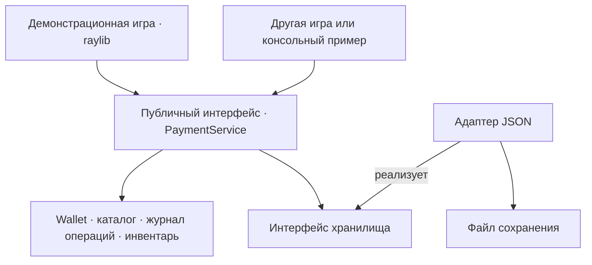
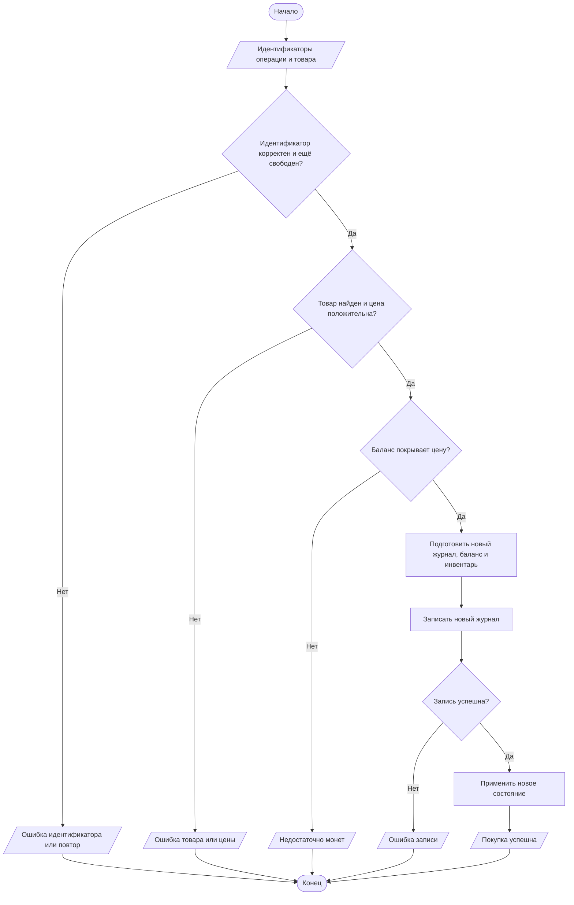

# Проектирование встраиваемой игровой платёжной системы

## Назначение

Платёжный модуль ведёт баланс виртуальных монет и обрабатывает покупки предметов через интерфейс C++. Пользователь демонстрационного приложения может получить монеты за тренировочное действие, купить предмет и увидеть его в инвентаре. После перезапуска приложение восстанавливает результаты операций. Модуль рассчитан на разработчика небольшой однопользовательской игры, демонстрационное приложение — на игрока и проверяющего.

## Анализ аналогов

| Решение | Баланс и хранение | Каталог и выдача предмета | История и повторные запросы | Подключение |
| --- | --- | --- | --- | --- |
| Unity Gaming Services Economy [1, 2] | Валюты и баланс игрока в Economy | Настраиваемая виртуальная покупка обменивает валюту или предметы на другие ресурсы | В документации рассмотренного сценария повтор по пользовательскому идентификатору не описан | Unity Gaming Services, конфигурация проекта в Dashboard |
| PlayFab Economy v2 [3, 4] | Виртуальная валюта представлена ресурсом инвентаря | Покупка по цене из каталога списывает валюту и выдаёт предмет | API истории. Ключ идемпотентности хранится 14 дней | PlayFab, API каталога и инвентаря |
| Heroic Labs Nakama [5, 6] | Серверный кошелёк и журнал изменений | Руководство показывает, как хранить цены и реализовать покупку предмета своей серверной функцией | Изменения кошелька доступны через журнал. Обработку повтора покупки нужно определить в своём сценарии | Сервер Nakama и собственная функция покупки |
| Разрабатываемая система | Один локальный кошелёк. Баланс восстанавливается по журналу | Встроенный демонстрационный каталог, покупка добавляет предмет в инвентарь | Локальная история успешных операций. Повтор идентификатора уже записанной операции отклоняется | Библиотека C++ с отдельным адаптером файла |

Из Unity Economy берём модель «цена → получаемый ресурс», из PlayFab — проверку идентификатора запроса, из Nakama — журнал изменений кошелька. Для локальной демонстрации достаточно одного профиля и одной валюты.

## Требования к первой рабочей версии

| № | Требование | Критерий приёмки |
| --- | --- | --- |
| Ф1 | Баланс и награда за тренировочное действие | У нового игрока 0 монет. Демонстрационное действие начисляет положительное целое количество. Ноль, отрицательная сумма и переполнение отклоняются |
| Ф2 | Каталог и покупка | Для каждого предмета показана цена. При покупке модуль берёт цену из каталога, списывает её и добавляет предмет |
| Ф3 | Проверка ошибок | Недостаток средств, неизвестный товар и недопустимая цена возвращают различимые ошибки. Баланс, инвентарь и история не меняются |
| Ф4 | Защита от повторной операции | Уже записанный идентификатор отклоняется, в том числе после перезапуска приложения |
| Ф5 | История и сохранение | После перезапуска сохраняются баланс, инвентарь и успешные операции. Повреждённый файл вызывает понятное сообщение и остаётся без изменений |
| Ф6 | Демонстрация интеграции | Из окна доступны тренировочное действие, магазин и просмотр инвентаря с историей. Отдельный консольный пример вызывает тот же модуль |
| Н1 | macOS на Apple Silicon | Сборка и проверка запуска на arm64. Игра работает локально после сборки |
| Н2 | Встраиваемость | Библиотека собирается и тестируется отдельно от raylib. Игровой клиент подключает библиотеку по публичным заголовкам C++ |
| Н3 | Согласованность данных | После успешной операции баланс, инвентарь и история соответствуют друг другу. Ошибка записи не оставляет частично выполненной покупки |
| Н4 | Воспроизводимость | README описывает запуск. CTest запускает проверки. Лицензии проекта и поставляемых компонентов доступны рядом с исходниками или сборкой |

## Выбор инструментов

| Средство | Лицензия или статус | Причина выбора |
| --- | --- | --- |
| C++17 и Clang [7, 8] | C++ — стандарт ISO. В основе Clang — LLVM под Apache-2.0 с исключениями LLVM | Нативная статическая библиотека для C++-игр. Явно заданы тип суммы и граница переполнения |
| Python, альтернатива [9] | CPython под PSF License v2 с уведомлениями о более ранних компонентах | Быстрое прототипирование. При интеграции с нативной C++-игрой потребовались бы Python-рантайм и граница между языками |
| Qt Creator [10] | Открытая редакция под GPLv3 с исключением Qt Company GPL Exception 1.0. Есть коммерческая редакция | IDE для CMake и отладки C++. Библиотеки Qt в приложение не входят |
| raylib [11] | zlib/libpng | Простые функции окна, ввода, рисования и текста. Поддерживается macOS. Версия 6.2 закреплена в CMake. Сборка arm64 проверена |
| SDL, альтернатива [12] | zlib для SDL 2 и новее | Подходит для нативной 2D-демонстрации. Для удобной работы со шрифтами обычно используют SDL_ttf |
| Godot, альтернатива [13] | MIT с отдельными уведомлениями для компонентов движка | Редактор сцен и интерфейсов был бы удобен для большой игры. Связь с отдельным C++-модулем добавляет шаг интеграции с движком |
| CMake и CTest [14, 15] | BSD-3-Clause для CMake | Один способ сборки из IDE и терминала. CTest входит в CMake и запускает проверки без отдельного тестового фреймворка |
| Git и GitHub [16] | Git под GPLv2. GitHub — удалённый хостинг | История изменений в отдельном каталоге публичного учебного репозитория |
| nlohmann/json 3.12.0 [17] | MIT | Проверенный парсер формата JSON в отдельном адаптере хранения |
| Исходники курсовой [18] | MIT | Допускает повторное использование исходников при сохранении текста лицензии и уведомления об авторском праве |

Лицензия исходников проекта совместима с использованием raylib и nlohmann/json на указанных условиях. При распространении сохраняются уведомления компонентов, которые войдут в поставку, в том числе поставляемых зависимостей raylib и ресурсов. Qt Creator, CMake и Git используются как инструменты разработки.

## Архитектура

Вход покупки — идентификаторы операции и товара. Модуль ищет цену в собственном каталоге. Проверки выполняются до изменений. Затем сервис формирует новую версию журнала и сохраняет её. Баланс и инвентарь обновляются после успешной записи. JSON хранит версию формата, идентификатор каждой операции, тип, сумму и идентификатор товара для покупки. Баланс и инвентарь восстанавливаются проигрыванием журнала с проверкой записей от начала. Цена в старой покупке берётся из записи журнала, поэтому изменение каталога сохраняет историю.

Хранилище записывает новый снимок во временный файл в том же каталоге и заменит основной файл после успешной записи. Отсутствующий файл означает первый запуск. Повреждённый или недоступный файл блокирует операции с сохранением и даёт диагностическое сообщение. Хранилище удерживает отдельную блокировку профиля, чтобы два процесса не записывали один файл одновременно.

### Алгоритм покупки

В окне размещены баланс и действие для получения монет сверху, карточки магазина с ценами по центру, инвентарь и последние операции сбоку. Для отказа или успеха предусмотрена строка состояния рядом с покупкой.

| Каталог | Назначение |
| --- | --- |
| `include/game_payments/` | Публичные типы и методы библиотеки |
| `src/` | Реализация кошелька и обработки транзакций |
| `storage/` | Адаптер JSON |
| `app/` | Демонстрационное приложение на raylib |
| `examples/` | Пример использования модуля из консоли |
| `tests/` | Автоматизированные проверки |
| `docs/` | Проектирование, инструкция и схемы |

## Материалы и испытания

- [Сравнение подходов](figures/analogs.svg)
- [Архитектура](figures/architecture.svg)
- [Алгоритм покупки](figures/purchase.svg)
- [Макет окна](figures/mockup.svg)

На macOS arm64 прошли 14 тестов CTest. Консольный пример дважды дал баланс 40 и две записи. Графический сценарий подтвердил отказ при балансе 50 и цене 60, покупку маяка с остатком 40, восстановление в новом процессе и сохранение повреждённого файла без изменений.

Порядок сборки и работы описан в [README](../README.md).

## Источники

1. Unity Technologies. [Introduction to resources in Economy](https://docs.unity.com/en-us/Economy/item-types).
2. Unity Technologies. [Virtual Shops](https://docs.unity.com/en-us/services/solutions/virtual-shops).
3. Microsoft. [Items and Inventory Overview](https://learn.microsoft.com/en-us/xbox/playfab/economy-monetization/economy-v2/inventory/items-and-inventory-overview).
4. Microsoft. [Idempotent transactions and retry patterns](https://learn.microsoft.com/en-us/gaming/playfab/economy-monetization/economy-v2/tutorials/idempotent-transactions-and-retries).
5. Heroic Labs. [Nakama — User accounts](https://heroiclabs.com/docs/nakama/concepts/user-accounts/).
6. Heroic Labs. [How to develop in-game economy systems](https://heroiclabs.com/docs/nakama/guides/concepts/economy/).
7. ISO. [ISO/IEC 14882:2017. Programming languages — C++](https://www.iso.org/standard/68564.html).
8. LLVM Project. [LLVM License](https://llvm.org/LICENSE.txt).
9. Python Software Foundation. [History and License](https://docs.python.org/3/license.html).
10. The Qt Company. [Qt Creator — Supported Platforms, Licenses and Attributions](https://github.com/qt-creator/qt-creator/blob/master/README.md).
11. raylib. [README версии 6.2](https://github.com/raysan5/raylib/tree/6.2), [лицензия](https://raw.githubusercontent.com/raysan5/raylib/6.2/LICENSE), [инструкция для macOS](https://github.com/raysan5/raylib/wiki/Working-on-macOS).
12. SDL. [Licensing](https://www.libsdl.org/license.php), [SDL_ttf](https://wiki.libsdl.org/SDL3_ttf/FrontPage).
13. Godot Engine. [License](https://godotengine.org/license/).
14. Kitware. [Licensing for CMake](https://cmake.org/licensing/).
15. Kitware. [CTest manual](https://cmake.org/cmake/help/latest/manual/ctest.1.html).
16. Git. [COPYING](https://github.com/git/git/blob/master/COPYING).
17. Niels Lohmann. [JSON for Modern C++ 3.12.0 — MIT License](https://github.com/nlohmann/json/blob/v3.12.0/LICENSE.MIT).
18. Open Source Initiative. [The MIT License](https://opensource.org/license/mit).
19. РТУ МИРЭА. [Инструкция по организации и проведению курсового проектирования](https://stavropol.mirea.ru/images/vipusk/instr.pdf).
20. Росстандарт. [ГОСТ 7.32-2017](https://protect.gost.ru/gost/details/7d280e43-7036-4a69-8e6e-d15867028343).
21. Росстандарт. [ГОСТ 19.701-90](https://protect.gost.ru/gost/details/0c85e066-f89e-433d-a6d3-b7f746bd0c7c).
